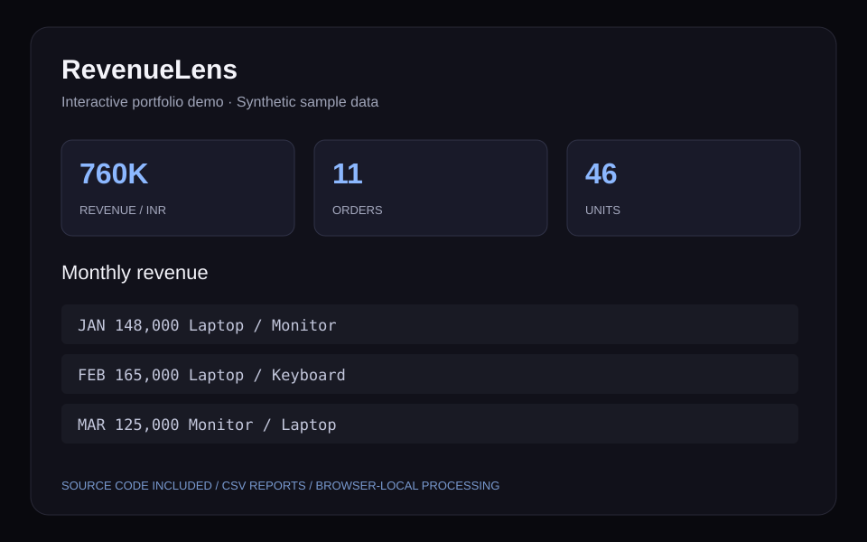

# RevenueLens — Sales Analysis

Analyze transaction CSVs, filter by region, calculate revenue and order value, and explore monthly and product performance with exportable summaries.

[](https://github.com/DEEPSXPLOIT/revenuelens-sales-analytics/actions/workflows/ci.yml)

## Why this project

Decision makers need consistent sales metrics and visibility into product and regional performance.

Validated line items are grouped by order, month, and product. Region filters recalculate metrics and summaries directly from source rows.

## Features

- Upload transaction data using the supplied schema
- Filter regions and compare monthly revenue
- Calculate distinct orders and average order value
- Export product-level revenue and units

## Run locally

Use Node.js 22 or newer and npm. No API keys, account, or database setup is required.

```bash
git clone https://github.com/DEEPSXPLOIT/revenuelens-sales-analytics.git
cd revenuelens-sales-analytics
npm ci
npm run dev
```

Open http://localhost:3014. The dedicated port allows these showcase apps to run alongside the portfolio.

```bash
npm test
npm run build
```

The build produces a static site in `out/`; serve that folder with any static web host. `npm run start` serves the exported build after `npm run build`.

## A quick recruiter walkthrough

1. Load the sample: revenue is INR 760,000 across 11 distinct orders.
2. Select South: revenue becomes INR 330,000 across 5 distinct orders.
3. Upload your own valid CSV and download monthly/product summaries.

## Input schema

```text
order_id, date, region, product, quantity, unit_price
```

Column names are case-sensitive. CSV uploads are limited to 1 MB and 2,000 rows. [Download the synthetic sample](public/sample-data.csv).

## Architecture

- `src/components/Application.js`: interactive dashboard and local state
- `src/lib/projectAnalytics.js`: independently tested CSV processing and analytics rules
- `src/data/demoData.js`: synthetic records
- `tests/`: parsing and project-specific regression checks
- `src/app/`: Next.js entry point with server-rendered styled-components setup

The implementation uses React, Next.js, styled-components, and plain JavaScript. All data processing happens in the browser. The reusable analytics module includes helpers shared across the five independently runnable projects.

## Preview illustration



This original illustration summarizes the sample interface; it is not an employer-system screenshot.

## Scope

Synthetic sales data; revenue is quantity × unit price in INR before taxes, discounts, and refunds. This is descriptive analysis, not a prediction model.

This is an independent portfolio project. It contains synthetic samples and no employer records. Uploaded files stay in memory; browser-local persistence is used only where the UI says so. Exported CSV cells are quoted and spreadsheet formula prefixes are neutralized.

## Author

Jaideep Mahendra · [GitHub](https://github.com/DEEPSXPLOIT) · [LinkedIn](https://linkedin.com/in/jaideep-mahendra)
